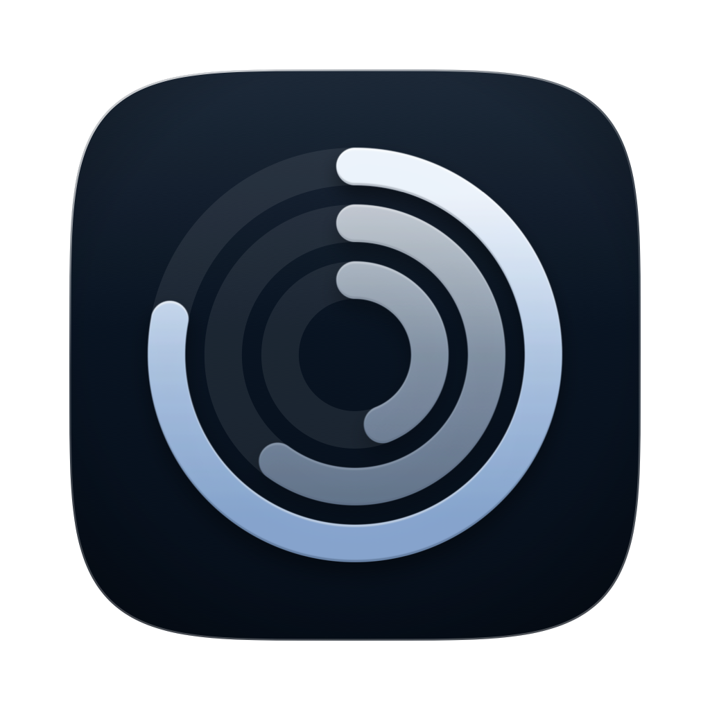
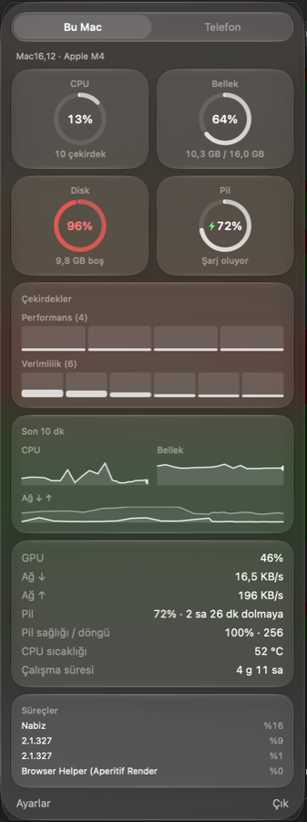

<div align="center">



# Nabız

**Your Mac and your Android phone, on each other's screen.**

A native macOS menu bar app and an Android companion. See each other's CPU, memory, storage, battery and network live, handle your phone's **calls and notifications** from the Mac, and keep an eye on your **Claude, Codex and Cursor limits** on both.
Local network only. No cloud, no account, end‑to‑end encrypted.

[English](#english) · [Türkçe](#türkçe)


<br>



</div>

---

## Quick install

**macOS** (15+, Apple Silicon & Intel) — paste into Terminal:

```bash
curl -fsSL https://raw.githubusercontent.com/serdarabdulkadir/nabiz/main/scripts/install-mac.sh | bash
```

**Android** (8+) — download **`Nabiz.apk`** from the [latest release](https://github.com/serdarabdulkadir/nabiz/releases/latest) and open it on your phone.
For automatic updates, add `https://github.com/serdarabdulkadir/nabiz` to [Obtainium](https://obtainium.imranr.dev).

Open Nabız on both devices on the same Wi‑Fi and confirm the 6‑digit code. Full walkthrough: [Setup, step by step](#setup-step-by-step).

---

## English

### What it does

| | On the Mac | On the phone |
|---|---|---|
| **Own stats** | CPU (performance / efficiency cores), GPU, memory + pressure, disk, network ↑↓, battery health & cycles, uptime, CPU temperature & fans, top 5 processes, Bluetooth device batteries, 10‑minute history graphs | Battery (level, charging, temperature), memory, storage, network, thermal status, 10‑minute history graphs |
| **The other device** | *Phone* tab in the menu bar panel | Mac card as a **Live Update** notification (Android 16 `ProgressStyle`; status bar chip / Xiaomi HyperOS *Super Island*) |
| **Calls** *(new in 0.4)* | Floating call bubble: answer, decline, hang up, live timer. Recent & missed calls, contacts, dial pad — click any number to call from the phone | Shares call state, contacts and call history — only if you turn it on |
| **Notifications** *(new in 0.4)* | Phone notifications in the panel, in a Phone window and as macOS banners. **Reply** inline or from the banner, dismiss one, or clear all | Shares notifications — only if you turn it on |
| **AI limits** *(new in 0.5)* | Claude, Codex and Cursor usage: 5‑hour and weekly limits, "full in 33 min at this pace", alerts at 75 % / 90 % and on reset, several accounts per tool, an **AI** column and 4 icon styles in the menu bar | The same cards in an **AI** tab (only percentages travel to the phone, never tokens) |
| **Remote actions** | — | Refresh, lock screen, sleep, wake display; Quick Settings tile |
| **Alerts** | Battery, charging, storage, CPU, memory, thermal and connection alerts with per‑device thresholds, hysteresis and cool‑down | Same alert engine, shown on the phone |
| **Look** | SwiftUI `MenuBarExtra`, Liquid Glass on macOS 26 (material fallback on 15), 6 menu bar styles | Jetpack Compose, light + dark, 5 notification designs |

Honest numbers only: anything that can't be read is shown as `--`. Android 8+ doesn't expose CPU usage, so the phone has no CPU tile.

### Platforms

| Platform | Status |
|---|---|
| macOS 15+ (Apple Silicon & Intel) | ✅ Menu bar app |
| Android 8+ (Live Update on Android 16+) | ✅ App + live notification |
| iOS | 🗺️ Planned — see [Roadmap](#roadmap) |

### Setup, step by step

**1. Install on the Mac**

1. Paste the [Quick install](#quick-install) command into Terminal. It downloads the latest `Nabiz-mac.zip`, copies `Nabız.app` to `/Applications` and opens it.
2. The Nabız icon appears in the menu bar. Click it to open the panel.
3. Allow **Local Network** and **Notifications** when macOS asks. If you denied notifications once, Nabız shows a shortcut to *System Settings → Notifications → Nabız*.

> The app is ad‑hoc signed, not notarized, so the script removes the download quarantine flag. Prefer doing it by hand? Download the zip from [Releases](https://github.com/serdarabdulkadir/nabiz/releases/latest), move the app to Applications, then right‑click → *Open* on first launch.

**2. Install on the phone**

1. Download `Nabiz.apk` from the [latest release](https://github.com/serdarabdulkadir/nabiz/releases/latest) and open it. Allow "install unknown apps" for your browser or file manager when asked.
2. Open Nabız and allow notifications (needed for the Mac card).
3. **Xiaomi / HyperOS / MIUI:** turn on *Autostart* and set battery to *No restrictions*, or the system will stop the live card. The app links you to both settings.

**3. Pair**

1. Keep both devices on the same Wi‑Fi (or the same hotspot).
2. The phone finds the Mac by itself. Both screens show a **6‑digit code**.
3. If the codes match, tap **Onayla** (Confirm) on both. Pairing is remembered; next time they reconnect on their own.

**4. Turn on calls & notifications** *(optional)*

On the phone: **Ayarlar → Mac ile paylaş** (*Settings → Share with Mac*; the app's interface is in Turkish). Everything here is **off by default**; turn on only what you want.

| Switch | What the Mac gets | What Android asks for |
|---|---|---|
| **Bildirimler** (Notifications) | Your notifications; reply, dismiss, clear all | *Notification access* (opens the system page — enable Nabız) |
| **Aramaları yönet** (Manage calls) | Incoming / ongoing call, answer, decline, hang up, dial | Phone, answer calls, make calls, call log (call log is needed on Android 9+ to see the caller's number) |
| **Kişiler** (Contacts) | Contact names and numbers (search, caller names) | Contacts |
| **Arama geçmişi** (Call history) | Recent and missed calls | Call log |

> **Xiaomi / HyperOS:** if *Notification access* is greyed out ("Restricted setting"), open *Settings → Apps → Nabız*, tap **⋮ → Allow restricted settings**, then try again.

The panel only shows a tile for what you turned on. You can hide the *Phone notifications* and *Phone calls* tiles in Mac **Settings → Modules**, and switch off Mac banners or the call bubble in **Settings → Phone**.

**5. Away from home** *(optional)*

Put both devices on the same [Tailscale](https://tailscale.com) network and enter the Mac's Tailscale address on the phone (**Ayarlar → Uzak adres**). The Mac shows its own Tailscale address in Settings. Pairing itself still only happens on the local network.

### How it works

```
 ┌──────────── Mac (server) ────────────┐        ┌────────── Android (client) ──────────┐
 │ Menu bar panel · Phone window        │        │ Live Update card · Quick Settings    │
 │ Call bubble · macOS banners          │        │ Foreground service                   │
 │                                      │        │  ├─ stats sampler                    │
 │ Bonjour  _nabiz._tcp  :47821  ◀──────┼─ Wi‑Fi ┼──┤  ├─ call listener (TelephonyCallback)│
 │                                      │  TCP   │  ├─ contacts / call log reader       │
 │ ECDH P‑256 → HKDF → AES‑256‑GCM  ◀───┼────────┼──┘  └─ NotificationListenerService   │
 └──────────────────────────────────────┘        └──────────────────────────────────────┘
```

1. **Discovery.** The Mac advertises `_nabiz._tcp` over Bonjour on port `47821`. The phone finds it on the same network.
2. **Pairing.** Each device has a long‑lived P‑256 key. On first contact both derive the same session keys (ECDH + HKDF‑SHA256) and show a 6‑digit code built from them; a man in the middle would produce different codes. After you confirm, each side pins the other's public key.
3. **Messages.** Every message is a small JSON object, encrypted with AES‑256‑GCM, with a counter that rejects replays. Stats flow every 2 s while a screen is open, 10 s otherwise.
4. **Calls.** The phone listens for call state, sends it to the Mac, and runs *answer / decline / hang up / dial* through Android's `TelecomManager` when the Mac asks.
5. **Notifications.** A `NotificationListenerService` forwards new and removed notifications (skipping ongoing, media, call and Nabız's own). *Reply* uses the notification's own reply action, the same as replying from the shade.

Full wire format and test vectors: [`docs/protokol.md`](docs/protokol.md). Both apps' tests read the shared examples in [`docs/fixtures/`](docs/fixtures).

### AI limits

Based on [AI Limit Tracker](https://github.com/bahadirnuroglu/ai_limit_tracker) by Bahadır Nuroğlu (MIT, used with permission — see [`mac/THIRD_PARTY.md`](mac/THIRD_PARTY.md)).

1. On the Mac: **Settings → AI**. Turn on Claude, Codex or Cursor.
2. If you already use Claude Code / Codex CLI / Cursor on this Mac, Nabız reads their existing session — nothing else to do. macOS may ask once for your password to read Claude Code's session: choose **Always Allow**.
3. Not signed in? **Giriş yap** starts the tool's own sign‑in in your browser. Another account (work / personal)? **Hesap ekle** opens a sign‑in window with its own separate cookie store.
4. Pick a menu bar style in **Settings → Menu Bar → AI simgesi**.

Nabız never stores or refreshes these tokens and doesn't use any tool's OAuth client id; it only reads what the tools themselves saved. It reads undocumented usage endpoints, so a provider change can break it.

### Privacy

- No servers, no accounts, no analytics. Data only travels between your own two paired devices, encrypted.
- Calls, contacts, call history and notifications are **off by default** and each needs its own switch plus the Android permission.
- The Mac keeps phone data **in memory only**: it's dropped when the phone disconnects or you turn a switch off. (macOS itself keeps the banners it showed in Notification Center, like any app.)
- While the Mac is locked or its display is off, banners show only the app name, never the message.
- Pairing keys: Mac in `~/Library/Application Support/Nabiz/` (mode `0600`), phone in a Keystore‑wrapped store.
- Call audio stays on the phone or your earbuds. Nabız never records or routes audio.

### Troubleshooting

| Problem | Fix |
|---|---|
| Phone can't find the Mac | Same Wi‑Fi? On the Mac: *System Settings → Privacy & Security → Local Network → Nabız* on. Guest / office networks often block device‑to‑device traffic; a phone hotspot works. |
| "Pairing key changed" | You reinstalled one side. Remove the pairing in Settings on both and pair again. |
| Live card disappears on Xiaomi | Autostart on, battery *No restrictions*, and lock Nabız in the recent‑apps screen. |
| No notifications on the Mac | Phone: *Mac ile paylaş → Bildirimler* on and *Notification access* granted. Mac: *Settings → Telefon → Telefon bildirimlerini Mac'te göster* on, and macOS notifications allowed for Nabız. |
| Hang up doesn't work | Some Xiaomi builds limit ending calls from other apps. Answer / decline usually still works. |
| "Different version" message | Update both apps to the same release. |

### Build from source

```bash
# macOS (Xcode 26 / Swift 6 toolchain)
cd mac
swift build && swift test
scripts/paketle.sh --ac                 # ~/Applications/Nabız.app, opens it
UNIVERSAL=1 scripts/paketle.sh          # Intel + Apple Silicon build

# Android (JDK 17)
cd android
./gradlew assembleDebug testDebugUnitTest
adb install -r app/build/outputs/apk/debug/app-debug.apk
# Release signing: create android/keystore.properties (storeFile, storePassword, keyAlias, keyPassword)
```

### Project layout

```
mac/        Swift 6 package: NabizCore (sampling, protocol, contacts, alerts — unit tested) + Nabiz (SwiftUI app)
android/    Kotlin + Compose app: stats, peer link, phone (calls/contacts), notif (listener), service, live card
docs/       wire protocol, design language, alert rules, shared test fixtures
assets/     logo sources, screenshots
```

### Roadmap

- **iOS companion** — a SwiftUI app sharing `NabizCore` that shows the Mac (with a Live Activity). iOS doesn't allow an always‑on background connection, so it needs its own design.
- SMS, clipboard and file transfer.
- Home‑screen widget on Android.
- Notarized macOS builds (needs a Developer ID certificate).

### Contributing

Issues and pull requests are welcome. Keep the rules in mind: no invented metrics (`--` when unknown), no new dependencies without a reason, logic in `NabizCore` / plain Kotlin with unit tests, UI only draws, sensitive phone features off by default.
Run `swift test` and `./gradlew testDebugUnitTest` before opening a PR. A wire‑format change on one side breaks the other side's fixture tests — that's on purpose.

### License

[MIT](LICENSE)

---

## Türkçe

**Nabız**, Mac ile Android telefonu birbirinin ekranına taşıyan açık kaynak bir uygulama çiftidir. İki cihaz birbirinin CPU, bellek, depolama, pil ve ağ durumunu canlı görür. Telefonun **aramalarını ve bildirimlerini** de Mac'ten yönetirsin. Yalnız yerel ağ: bulut yok, hesap yok, uçtan uca şifreli.

### Neler var

- **Mac (menü çubuğu):** kendi durumu (P/E çekirdekli CPU, GPU, bellek ve basınç, disk, ağ, pil sağlığı, sıcaklık ve fan, ilk 5 süreç, Bluetooth cihaz pilleri, 10 dakikalık grafikler) ve **Telefon** sekmesi.
- **Android:** telefonun kendi durumu ve Mac kartı. Kart, kalıcı canlı bildirimdir (Android 16 Live Update, HyperOS'ta Super Island). Karttan ya da Hızlı Ayarlar kutucuğundan yenile, kilitle, uyut, ekranı uyandır.
- **Aramalar (0.4'te yeni):** gelen aramada Mac'te yüzen baloncuk çıkar; Yanıtla, Reddet, Bitir ve süre sayacı vardır. Son ve cevapsız aramalar, kişiler ve tuş takımı da Mac'te. Bir numaraya tıklayınca arama telefondan başlar.
- **Bildirimler (0.4'te yeni):** telefon bildirimleri panelde, Telefon penceresinde ve macOS bildirimi olarak görünür. Satır içinden ya da bildirimden **yanıt verebilir**, tek tek kapatabilir ya da tümünü kapatabilirsin.
- **AI limitleri (0.5'te yeni):** Claude, Codex ve Cursor için 5 saatlik ve haftalık limitler, "bu hızla 33 dakikada tükenir" tahmini, %75/%90 ve sıfırlanma bildirimleri, araç başına birden çok hesap, menü çubuğunda AI sütunu ve 4 simge stili. Telefonda **AI** sekmesi. Mac'te **Ayarlar → AI**'dan açılır. [Bahadır Nuroğlu'nun AI Limit Tracker](https://github.com/bahadirnuroglu/ai_limit_tracker)'ından uyarlandı (MIT, izinli). Token'lar saklanmaz, telefona yalnız yüzdeler gider.
- **Uyarılar:** pil, şarj, depolama, CPU, bellek, ısınma ve bağlantı için cihaz başına eşik.

Uydurma değer yoktur: okunamayan her şey `--` görünür. Android 8 ve sonrası CPU kullanımını vermediği için telefonda CPU karosu yoktur.

### Kurulum adımları

**1. Mac**

1. Terminal'e şu komutu yapıştır:
   ```bash
   curl -fsSL https://raw.githubusercontent.com/serdarabdulkadir/nabiz/main/scripts/install-mac.sh | bash
   ```
   Komut son sürümü indirir, `Nabız.app`'i `/Applications` klasörüne koyar ve açar.
2. Menü çubuğunda Nabız simgesi çıkar. Tıklayınca panel açılır.
3. macOS **Yerel Ağ** ve **Bildirimler** izni sorduğunda izin ver.

> Uygulama notarize edilmediği için komut indirme karantinasını kaldırır. Elle kurmak istersen [Releases](https://github.com/serdarabdulkadir/nabiz/releases/latest) sayfasından zip'i indir, uygulamayı Uygulamalar klasörüne taşı ve ilk açılışta sağ tık → *Aç* de.

**2. Telefon**

1. [Son sürümden](https://github.com/serdarabdulkadir/nabiz/releases/latest) `Nabiz.apk` dosyasını indirip aç. "Bilinmeyen uygulamaları yükle" izni sorulursa ver.
2. Nabız'ı aç ve bildirim izni ver (Mac kartı için gerekli).
3. **Xiaomi / HyperOS:** *Otomatik başlatma*yı aç ve pil tasarrufunu *Kısıtlama yok* yap. Yoksa sistem canlı kartı kapatır. Uygulama iki ayara da yönlendirir.

**3. Eşleşme**

1. İki cihaz aynı Wi‑Fi'da (ya da aynı hotspot'ta) olsun.
2. Telefon Mac'i kendisi bulur. İki ekranda **6 haneli kod** çıkar.
3. Kodlar aynıysa ikisinde de **Onayla**'ya bas. Eşleşme hatırlanır; sonraki seferlerde kendiliğinden bağlanır.

**4. Aramalar ve bildirimler** *(isteğe bağlı)*

Telefonda **Ayarlar → Mac ile paylaş** bölümünü aç. Buradaki her şey **varsayılan olarak kapalıdır**; yalnız istediğini aç.

| Anahtar | Mac ne görür | Android ne ister |
|---|---|---|
| **Bildirimler** | Bildirimler; yanıtla, kapat, tümünü kapat | *Bildirim erişimi* (sistem sayfası açılır, Nabız'ı etkinleştir) |
| **Aramaları yönet** | Gelen ve süren arama; yanıtla, reddet, bitir, ara | Telefon, arama yanıtlama, arama yapma, arama kaydı (Android 9+'ta arayanın numarası için gerekli) |
| **Kişiler** | Kişi adları ve numaraları | Kişiler |
| **Arama geçmişi** | Son ve cevapsız aramalar | Arama kaydı |

> **Xiaomi / HyperOS:** *Bildirim erişimi* gri ve "Kısıtlı ayar" diyorsa *Ayarlar → Uygulamalar → Nabız*'a gir, sağ üstte **⋮ → Kısıtlı ayarlara izin ver**'e bas ve tekrar dene.

Mac panelinde yalnız açtığın özelliğin karosu görünür. *Telefon bildirimleri* ve *Telefon aramaları* karolarını Mac'te **Ayarlar → Modüller**'den gizleyebilir, macOS bildirimlerini ya da arama baloncuğunu **Ayarlar → Telefon**'dan kapatabilirsin.

**5. Evden uzakta** *(isteğe bağlı)*

İki cihazı aynı [Tailscale](https://tailscale.com) ağına al ve telefonda **Ayarlar → Uzak adres** alanına Mac'in Tailscale adresini yaz. Mac kendi adresini Ayarlar'da gösterir. İlk eşleşme yine yalnız yerel ağda yapılır.

### Sistem nasıl çalışır

1. **Bulma:** Mac, Bonjour ile `_nabiz._tcp` servisini `47821` portunda duyurur. Telefon aynı ağda onu bulur ve bağlanır. Mac sunucu, telefon istemcidir.
2. **Eşleşme:** her cihazın kalıcı bir P‑256 anahtarı vardır. İlk bağlantıda iki taraf ECDH + HKDF‑SHA256 ile aynı oturum anahtarlarını türetir ve bunlardan 6 haneli kodu üretir. Araya giren biri farklı kod üreteceği için kodları karşılaştırmak bu saldırıyı önler. Onaydan sonra iki taraf da karşının açık anahtarını sabitler.
3. **Mesajlar:** her mesaj küçük bir JSON nesnesidir ve AES‑256‑GCM ile şifrelenir. Sayaç sayesinde tekrar gönderilen paket reddedilir. Durum bilgisi ekran açıkken 2 sn'de, kapalıyken 10 sn'de bir gider.
4. **Aramalar:** telefon arama durumunu dinler ve Mac'e bildirir. Mac *yanıtla / reddet / bitir / ara* dediğinde telefon bunu Android'in `TelecomManager` servisiyle yapar.
5. **Bildirimler:** `NotificationListenerService` yeni ve kapanan bildirimleri Mac'e iletir. Süren, medya, arama ve Nabız'ın kendi bildirimleri gönderilmez. *Yanıtla*, bildirimin kendi yanıt eylemini kullanır; bildirim panelinden yanıt vermekle aynıdır.

Protokolün tamamı: [`docs/protokol.md`](docs/protokol.md).

### Gizlilik

- Sunucu, hesap ve analitik yok. Veri yalnız eşleşmiş iki cihazın arasında, şifreli gider.
- Aramalar, kişiler, arama geçmişi ve bildirimler **varsayılan kapalıdır**. Her biri ayrı anahtar ve Android izni ister.
- Mac telefon verisini **yalnız bellekte** tutar. Bağlantı kopunca ya da anahtarı kapatınca silinir. (macOS, gösterdiği bildirimleri her uygulamada olduğu gibi kendi Bildirim Merkezi'nde tutar.)
- Mac kilitliyken ya da ekranı kapalıyken bildirimde yalnız uygulama adı görünür, mesaj içeriği görünmez.
- Arama sesi telefonda ya da kulaklıkta kalır. Nabız sesi kaydetmez ve aktarmaz.

### Sorun giderme

| Sorun | Çözüm |
|---|---|
| Telefon Mac'i bulamıyor | Aynı Wi‑Fi'da mısınız? Mac'te *Sistem Ayarları → Gizlilik ve Güvenlik → Yerel Ağ → Nabız* açık olmalı. Misafir ve ofis ağları cihazlar arası trafiği engelleyebilir; telefon hotspot'u çalışır. |
| "Eşleşme anahtarı değişti" | Bir taraf yeniden kurulmuş. İki cihazda da Ayarlar'dan eşleşmeyi kaldırıp yeniden eşle. |
| Xiaomi'de canlı kart kayboluyor | Otomatik başlatma açık, pil *Kısıtlama yok* olsun ve Nabız'ı son uygulamalar ekranında kilitle. |
| Mac'e bildirim gelmiyor | Telefonda *Mac ile paylaş → Bildirimler* açık ve *Bildirim erişimi* verilmiş olmalı. Mac'te *Ayarlar → Telefon → Telefon bildirimlerini Mac'te göster* açık ve macOS bildirim izni verilmiş olmalı. |
| Aramayı bitir çalışmıyor | Bazı Xiaomi sürümleri başka uygulamanın aramayı bitirmesini kısıtlar. Yanıtla ve reddet genelde çalışır. |
| "Farklı sürüm" uyarısı | İki uygulamayı da aynı sürüme güncelle. |

Kaynaktan derleme ve proje yapısı için yukarıdaki İngilizce bölüme bak. Lisans: MIT.
